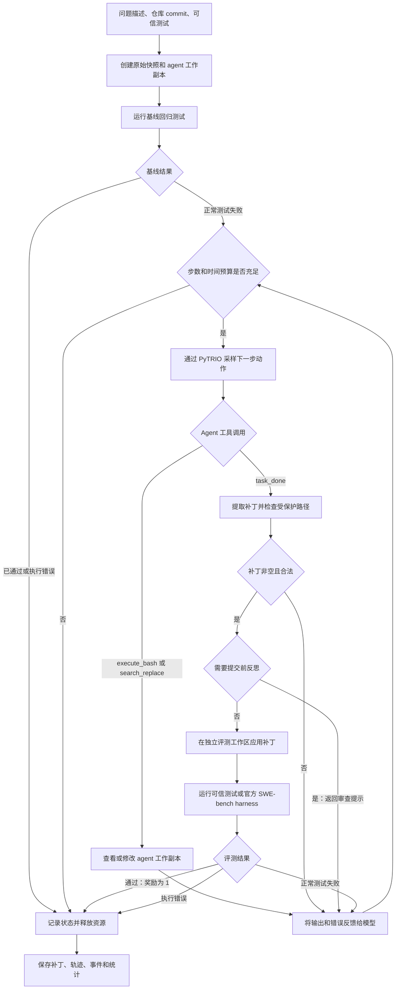
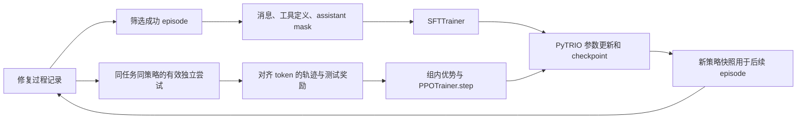

# Triotune

**基于 PyTRIO 的训练案例与训练器组件。**

Triotune 基于 PyTRIO 公共客户端 API，提供文本训练案例、训练器组件和 SWE agent 工作流。项目负责数据准备、奖励与优势计算、token 对齐以及训练循环编排；PyTRIO 提供模型执行、分词、采样和优化能力。

<p align="center">
  <a href="README.md">English</a>
</p>


## 🗂️ 目录

- [项目简介](#-项目简介)
- [近期动态](#-近期动态)
- [安装](#-安装)
- [算法](#-算法)
- [数据契约](#-数据契约)
- [Token 用量指标](#token-用量指标)
- [Python API](#-python-api)
- [Triotune-SWE 原理](#triotune-swe-原理)
- [文档](#文档)
- [仓库结构](#-仓库结构)
- [当前范围](#-当前范围)

## 👋 项目简介

Triotune 为若干基于 PyTRIO 的训练算法提供类似 Trainer 的使用方式。它只负责客户端侧逻辑；模型权重、LoRA 训练客户端、tokenizer、采样、前向/反向、优化器更新和 checkpoint 存储仍由 PyTRIO 提供。

当前包含以下训练器：

- **PPO**：一个异步 trainer 支持 PPO、GRPO、RLOO、GSPO、SAPO、CISPO、DAPO 等预设。
- **DPO**：chosen/rejected 偏好对、可选的 reference policy 打分，以及通过 PyTRIO 提交的本地成对损失。
- **SFT**：纯文本监督微调，支持 prompt/completion mask，并提供异步训练路径。
- **OPD**：在线蒸馏，由学生模型采样 completion，再由固定教师模型提供 token 级分数。

在底层 PyTRIO 客户端支持的前提下，PPO、DPO 和 OPD 提供异步训练路径。公共工具统一处理文本、token ID 和聊天消息输入，以及 checkpoint 命名和 SwanLab 指标记录。

Triotune-SWE 将模型采样、coding agent 和独立任务环境连接起来，根据问题描述生成经过测试的代码补丁，并将修复过程用于监督微调或强化学习。

## 📰 近期动态

- **2026-10-19：** Triotune 0.1.1 统一了数据集预处理格式，并将发行包和源码目录重命名为 triotune，同时新增模块化 PPO、在策略蒸馏流程及基于 YAML 的训练配方配置。
- **2026-10-12：** Triotune 0.1.0（pytrio-cookbook）首次发布到 [PyPI](https://pypi.org/project/pytrio-cookbook/)。

## 🚀 开始使用

### 📦 安装

- Python 3.12（当前包声明 >=3.12,<3.13）
- 可用的 PyTRIO 训练服务，以及该案例所使用模型的访问权限

在 macOS 或 Linux 上安装 [uv](https://docs.astral.sh/uv/)：

```bash
curl -LsSf https://astral.sh/uv/install.sh | sh
```

在 Windows PowerShell 中运行官方安装命令：

```powershell
powershell -ExecutionPolicy ByPass -c "irm https://astral.sh/uv/install.ps1 | iex"
```

然后克隆仓库并创建由锁文件约束的完整环境：

```bash
git clone https://github.com/SwanHubX/triotune.git
cd triotune
uv python install 3.12
uv sync --locked --all-extras
uv run python -c "import triotune; print(triotune.__name__)"
```

### 📚 快速开始

通过 YAML 配置运行 GSM8K PPO 示例：

```bash
uv run python examples/ppo/gsm8k_ppo.py --config examples/ppo/gsm8k_ppo_args.yaml
```

## 🔧 支持矩阵

### 🧠 算法

| 算法 | 文档 | 案例 |论文 |
| --- | --- | --- | --- |
| **GRPO** | [📖 文档](./docs/algorithms/grpo_series.md) | [🔧 案例](./examples/grpo) | [📄 论文](https://arxiv.org/abs/2402.03300) |
| **PPO** | [📖 文档](./docs/algorithms/ppo_series_CN.md) | [🔧 案例](./examples/ppo) | [📄 论文](https://arxiv.org/abs/1707.06347) |
| **DPO** | - | - | [📄 论文](https://arxiv.org/abs/2305.18290) |
| **OPD** | - | - | [📄 论文](https://arxiv.org/abs/2601.18734) |
| **SFT** | - | - |  |

### 📖 模型

PyTRIO 当前支持以下模型：

- Qwen/Qwen3.5-4B
- Qwen/Qwen3.5-9B
- Qwen/Qwen3.8-27B

## 🧩 数据契约

训练器有意只接受以下几种基础输入：

- 字符串；
- 非空 token ID 列表；
- 非空的 {role, content} 聊天消息列表。

各算法的字段要求如下：

- **GRPO：** messages 和由 reward 函数使用的字符串 answer；
- **DPO：** 共享的 messages，以及 chosen、rejected 回复；
- **SFT：** text、messages、prompt/completion，或预分词的 input_ids（可选 labels）；
- **OPD：** prompt 行，教师会对学生采样的 completion 打分。

字段校验规则和完整 JSONL 示例见 [trainer 说明](triotune/trainer/README.md)。

## Token 用量指标

PyTRIO 记录 training tokens 、prefill tokens 和 sampler tokens 。Triotune 在 SwanLab 中记录对应数量及累计值，采样优先使用 PyTRIO 返回的计数，训练按实际提交的计算请求累计。两端通常一致，但本地回退计数、失败或重试请求可能造成偏差，最终以 PyTRIO 服务端记录为准。

## 🐍 Python API

最简 GRPO 训练流程会使用默认配置，为每个 prompt 采样 4 个回复：

```python
import asyncio

from triotune.trainer import PPOConfig, PPOTrainer


asyncio.run(
    PPOTrainer(
        model="your-pytrio-model-id",
        args=PPOConfig.for_algorithm("grpo"),
        reward_fn=lambda row, completion, **_: float(row["answer"] in completion),
        train_dataset=[{"messages": "What is 2 + 2?", "answer": "4"}],
    ).train()
)
```

## Triotune-SWE 原理

Triotune-SWE 通过测试反馈驱动模型完成软件修复：先复现问题，再查看和修改代码，提交补丁后独立验证。模型决定动作，环境执行动作，独立评测结果决定奖励。

### 三层架构

| 组件 | 入口 | 职责 |
| --- | --- | --- |
| 模型与训练桥接 | triotune.swe / PyTRIOSWEModel | 调用 PyTRIO，记录真实 prompt/completion token 和行为策略 logprob，标识策略快照，转换训练轨迹。 |
| Agent 执行 | [Triotune-SWEAgent](https://github.com/SwanHubX/Triotune-SWEAgent) / tswe.SWEAgent | 管理任务提示词、工具调用、失败反馈、上下文、执行预算和轨迹产物。 |
| 任务环境 | [Triotune-Environment](https://github.com/SwanHubX/Triotune-Environment) / tenv.TenvSWE | 创建 Git 快照，在 Docker 工作区执行命令、编辑文件、提取补丁，并在新工作区独立评分。 |

Agent 和环境分别维护在独立仓库中。运行下方命令前，需要将兼容版本放在 playground 对应目录下。

### 自动修复闭环



1. **准备任务与复现问题。** 任务包含 issue、干净的本地 Git 仓库、基准 commit、可信测试命令和受保护路径。环境提取已提交文件，并在独立工作区执行基线测试。基线已经通过时直接记录状态，不给予修复奖励；执行错误与正常测试失败分别处理。
2. **根据观察采取动作。** 模型接收 issue、基线失败信息、对话历史和工具定义，通过 execute_bash 查看代码或运行命令，通过 search_replace 精确修改文件，通过 task_done 提交结果。工具输出进入下一轮决策。持久 shell 保留目录和 export 状态，超时后重建 shell。启用提交前反思时，首次非空提交会先返回补丁审查提示，模型可以继续检查和修改。
3. **独立验证与奖励。** 提交时检查补丁是否修改受保护文件。评测从原始快照创建新工作区，应用补丁后运行可信测试；agent shell 状态和被改写的测试文件不会直接带入命令评分。正常测试失败会反馈给模型继续修复，验证通过后奖励为 1，未成功的任务保持奖励 0。基础设施故障单独记录，相关 episode 不进入 PPO 训练数据。
4. **预算与执行记录。** 总步数和总耗时约束一次 episode。模型请求、环境启动和评分可以针对瞬时基础设施故障重试；可选的整任务重启仍共享原有总预算。上下文策略可保留最近 reasoning 或完整轮次。资源租约记录本次进程与容器，支持崩溃后的残留清理，维护命令默认只预览。

默认使用 Docker，关闭网络、只读根文件系统、移除 capabilities，并限制 CPU、内存和进程数；项目依赖需要预装在任务镜像中。源仓库保持不变，修复通过 patch.diff 交付。episode.json 保存完整记录，trajectory.jsonl 保存 SFT 数据，events.jsonl 和 metrics.json 保存执行事件与用量统计。

可选的 SWE-bench 后端将非空补丁交给官方 harness，根据实例报告判定修复是否成功。空补丁基线仍使用任务提供的回归命令。官方 harness 的依赖、数据集和镜像需要另行准备；适配器契约测试不代表已取得基准评测成绩。

### 从修复过程到模型训练



- **SFT：** 筛选成功 episode，导出 messages 和 tools，通过 prepare_swe_sft_dataset 预处理后交给 SFTTrainer。训练使用聊天模板提供的 token mask 学习 assistant 决策；预处理与训练的长度限制需要一致，模板需要提供准确的 assistant mask。
- **PPO / GRPO：** 针对同一个任务，使用同一份不可变策略快照执行多次独立修复。每个完整 episode 转为一条带测试奖励的 Trajectory；一次 episode 内的多轮工具交互属于同一次尝试。同组轨迹使用相同 group_id 计算相对优势，再由 PPOTrainer.step 通过 PyTRIO 更新参数。示例要求组内奖励存在差异，更新后导出新的采样快照供下一组任务使用。

强化学习转换保留实际采样 token ID 和行为策略 logprob。工具观察和模板插入 token 的 loss_mask 为 false，采样得到的 assistant token 承担训练损失。一条连续轨迹要求单一策略版本、temperature = 1、top_p = 1，且后续 prompt 必须精确延续此前采样 token 历史。上下文压缩或聊天模板改写历史时，会拒绝连续 PPO 轨迹导出，逐轮真实样本仍保留在 episode 记录中。运行 agent 负责采集数据，训练由独立的 SFT 或 RL 入口显式启动。

### 运行入口

将两个配套仓库放到对应位置后，从 triotune 仓库根目录执行：

```bash
uv pip install -e . -e playground/Triotune-Environment -e playground/Triotune-SWEAgent
docker build -t triotune-swe:py312 playground/Triotune-Environment
uv run python -m tswe playground/Triotune-SWEAgent/examples/task.yaml --output output/swe
```

运行前需要在 task.yaml 配置任务仓库、issue、测试命令和模型。PyTRIO 凭证保留在控制端。SFT 与 RL 示例分别位于 agent 仓库的 examples/train_sft.py 和 examples/train_rl.py。配置、产物和验证说明见 [SWE 运行指南](docs/swe_runtime_CN.md)。

## 文档

- [训练器说明](triotune/trainer/README.md)
- [PPO 算法原理](docs/algorithms/ppo_series_CN.md)
- [GRPO 算法原理](docs/algorithms/grpo_series_CN.md)
- [Triotune-SWE 运行指南](docs/swe_runtime_CN.md)

## 🗃 仓库结构

```text
triotune/
├── api/           # 公共配置与 client 契约
├── dataset/       # 共享数据校验与分词
├── swe/           # SWE 采样与训练轨迹契约
├── trainer/       # 算法 trainer 与组件
└── utils/         # 公共运行时工具
```

## 🎯 当前范围

Triotune 当前聚焦于纯文本、基于 PyTRIO 的实验。项目不宣称提供 Web UI、Megatron 集成、多模态训练，也不提供通用的插件/注册表系统。如果需要使用自定义模型模块，请先让它适配 PyTRIO 的公共客户端契约，再使用现有 trainer 接口；“任意自定义模块注册”是后续工作，不是 0.1.2 已支持的能力。
