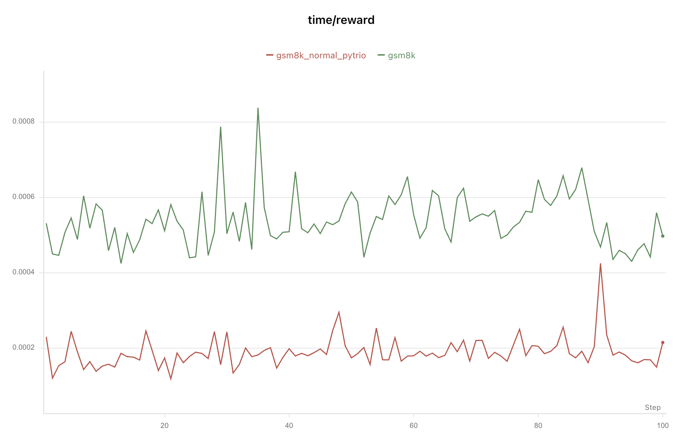
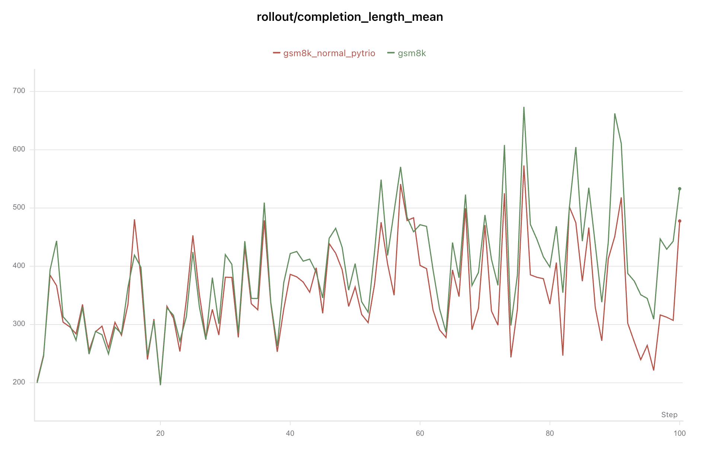

# GRPO PyTRIO 与独立脚本评测结果对比

本文对比以下两个 SwanLab 本地运行文件中的标量记录（通过 SwanLab 0.10.1 的 `DataStoreReader` 读取 `.swanlab` 内的 protobuf 记录，并按指标名、step 汇总）：

| 运行 | 运行时间/ID | 入口 | 关键配置 |
| --- | --- | --- | --- |
| A（框架 trainer） | `run-20260928_154652-cu89k24d` | `recipes/grpo_gms8k_trio.py --config .../grpo_gms8k.toml` | Qwen3.5-9B、LoRA 32、batch=4、group=8、max=1024、100 steps、lr=4e-5、`importance_sampling`、seed=42 |
| B（独立同步脚本） | `run-20260928_164802-cjhau8h5` | `recipes/grpo_gsm8k.py --steps 100 ...` | 与 A 相同（metadata 中记录的模型、batch、group、max、lr、loss、seed 均一致） |

## 核心指标

下表是每个运行 100 个训练 step 的均值；时间单位为秒。`loss`/`KL` 只在存在有效 Datum 的 step 记录，所以不能把它们当成 100 个 step 的均值。

| 指标 | A | B | A−B | 相对 B |
| --- | ---: | ---: | ---: | ---: |
| `reward/mean` | 0.924375 | 0.932813 | −0.008438 | −0.90% |
| `reward/std` | 0.169053 | 0.152526 | +0.016527 | +10.84% |
| `policy/entropy` | 0.136940 | 0.131983 | +0.004957 | +3.76% |
| `rollout/completion_length_mean` | 393.489 | 353.515 | +39.974 token | +11.31% |
| 每 step 的 `completion_length_max` 均值 | 778.40 | 691.98 | +86.42 token | +12.49% |
| 达到 1024 上限的 step 数 | 39 | 29 | +10 | — |
| `trainer/num_datums` | 4.40 | 3.76 | +0.64 | +17.02% |
| `trainer/skipped_groups` | 3.45 | 3.53 | −0.08 | −2.27% |
| `policy/kl_sample_train`（有值 step） | 0.00033131 | 0.00034189 | −0.00001058 | −3.09% |
| `trainer/loss`（有值 step） | 0.059036 | 0.064071 | −0.005035 | −7.86% |
| `time/rollout` | 25.8038 | 23.5220 | +2.2818 | +9.70% |
| `time/reward` | 0.0005398 | 0.0001892 | +0.0003506 | +185.32% |
| `time/train` | 1.9481 | 1.3070 | +0.6411 | +49.05% |
| `time/step` | 27.7803 | 24.8352 | +2.9451 | +11.86% |

总耗时也吻合这个趋势：A 的 100 个 `time/step` 之和为 2778.03 秒，B 为 2483.52 秒；B 额外记录的 `time/run` 为 2488.61 秒（约 5.09 秒为初始化、保存权重等非 step 开销）。

奖励差异很小：A 的平均奖励比 B 低 0.84375 个百分点，最终 step 两者都为 0.75。两者的奖励都来自 `\boxed{}` 最后一个答案，不能据此判断某一侧的 reward 公式错误。

## 训练信号与 loss 的解释

A 有 48 个 step 产生 `loss_mean`/`policy/kl_sample_train`，52 个 step 因所有 group 都是零 advantage 而跳过；B 分别为 39 和 61。有效 Datum 平均数也从 B 的 3.76 变为 A 的 4.40。也就是说，两个运行实际更新的 batch 集合不同；`loss` 的均值只在 34 个共同有值 step 上可配对，不能把 0.005 的差异解释成同一个 batch 上的数值误差。

两条实现的 GRPO 数学路径是相同的：每个 prompt 的 8 个 completion 使用 `reward - group_mean`，全组 advantage 为 0 时跳过，Datum 使用 prompt/completion 的 one-token shift，最后调用 `importance_sampling`。对应代码分别是：

- A：`trainer/grpo_trainer.py` 的 `_build_datums()`、`_train_datums()` 和 `_training_metrics()`；
- B：独立脚本的 `score_rollout_group()`、`build_grpo_datum()` 和 `run_optimization_step()`。

因此，A/B 的 reward、有效 Datum 数、loss、KL 差异首先来自 rollout 样本不同（以及由此产生的 zero-advantage group 数不同），而不是已观察到的 GRPO 公式分支差异。

## 差异来源判断

两次运行的差异可直接对应到以下代码路径：

1. **生成长度/rollout 时间**：独立脚本历史版本的 `get_stop_sequences()` 会把 `eos_token`、`<|im_end|>` 传给 `SamplingParams`；`GRPOConfig.sampling_params` 没有 `stop` 字段。前者会提前截断 completion，因此可解释 B 的长度和 rollout 时间更低。
2. **reward、Datum 数和 loss/KL**：A 由 `GRPOTrainer._build_datums()` 按 `skip_zero_advantage` 跳过退化 group，B 由独立脚本的 `score_rollout_group()`/训练循环执行同一逻辑。两边公式一致，差异来自远端 rollout 样本不同，进而导致有效 Datum 数（48/39 个有 loss 的 step）不同。
3. **reward 时间**：A 的 `RewardEvaluator.score()` 通过 `asyncio.run()` 和通用参数展开调用 reward；B 直接同步执行 `grade_answer()`，所以 A 的 `time/reward` 多约 0.35 ms/step。
4. **训练时间**：A 的 `_training_metrics()` 额外计算 `policy/kl_sample_train`，且 A 的 completion/有效 Datum 更长更多，导致 `time/train` 更高；A 还在 `save_every=100` 时执行 `GRPOTrainer._save_state()`，B 只在训练结束保存 sampler。
5. **prompt/seed 复现**：A 通过 `render_prompt()` 和 `GRPOTrainer` 传递 seed；独立脚本对应 `build_prompt()`、`SamplingParams` 和训练客户端。两次 metadata 未记录运行时未提交改动，因此 prompt 渲染和 seed 是否完全一致无法仅凭日志确认。

## 结论

1. 关于 `time/reward` 相差如此之大的原因是：牺牲了少量本地 reward 调用性能，换取了 reward 接口的可扩展性、校验能力和统一日志能力。

   - 同时支持同步和异步 reward 函数
   - 支持多个 reward 函数及 reward_weights 加权

具体表现为：每个 step 都通过 asyncio.run() 创建/关闭事件循环->构造 prompts、completions、completion_ids 和其他数据列->经过通用 reward 函数适配层，再进行结果校验、聚合和分组

这些抽象确实产生了额外开销；但在复杂或异步 reward 场景下是必要的。

2. 本次实验A有随机种子 `seed` 的限制，因此训练会话初始化以及推理采样的时候都是固定的，但是B没有设置。这里的 seed 主要是固定 GRPO rollout 的生成随机性，同时用于训练客户端初始化；不是给每个 optimizer step 单独设置的训练 seed。即使 seed 相同，模型权重在每步更新、请求状态或远端服务行为不同，后续生成结果仍可能不同。不过从结果上来看差距不大，因此认为框架可行

3. `rollout/completion_length_mean`差的稍微有点多

原因是生成停止条件不同，其次是采样随机性差异在训练过程中累积放大。

A没有设置stop，completion 可能继续生成到更长，更多序列达到 max_tokens=1024；

B现通过 get_stop_sequences() 传入了 eos_token 和 <|im_end|>，遇到结束标记会更早截断。

**因此需要调整输入参数，让A具备提前截断的能力。**

## 4×4 数独实验对比

数独实验同样读取 SwanLab 0.10.1 的本地记录，并选择最近完成的两次 100-step 运行：

| 运行 | 运行时间/ID | 入口 | 关键配置 |
| --- | --- | --- | --- |
| A（框架 trainer） | `run-20260930_152543-xdz9w1bd` | `recipes/grpo_sudoku_trio.py` | Qwen3.5-4B、LoRA 8、batch=2、group=6、max=1648、lr=3e-5、seed=42 |
| B（独立同步脚本） | `run-20260930_134102-atv548d4` | `recipes/grpo_sudoku.py` | 与 A 相同 |

两次运行都使用 simple 难度的 518 条训练数据和 `importance_sampling`。A 的 metadata 记录 commit `6dd4453`，B 记录 `6109d77`；B 运行时数独 recipe 尚未提交，因此本节用于比较实际训练行为，不能作为两个 commit 严格复现的证明。

| 指标 | A | B | A−B |
| --- | ---: | ---: | ---: |
| `reward/mean` | 2.950858 | 2.953620 | −0.002762 |
| `reward/exact/mean` | 82.08% | 83.92% | −1.83 pp |
| `reward/std` | 0.079248 | 0.063639 | +0.015609 |
| `rollout/completion_length_mean` | 76.146 | 72.156 | +3.990 token |
| `rollout/degenerate_fraction` | 76.0% | 82.0% | −6.0 pp |
| `trainer/num_datums` | 2.88 | 2.16 | +0.72 |
| 有 `trainer/loss` 的 step 数 | 42 | 30 | +12 |
| `trainer/loss`（有值 step） | 0.165072 | 0.203661 | −0.038589 |
| `policy/kl_sample_train`（有值 step） | 0.00025311 | 0.00018280 | +0.00007031 |

两边平均 reward 都达到满分 3.0 的 98% 以上，均值只差约 0.09%，说明框架版与独立版的 prompt、奖励和 GRPO 更新路径整体一致。A 的退化组更少，因此产生了更多有效 Datum 和 optimizer step；相应的 loss、KL 差异主要来自实际采样回答不同，不能解释为同一批数据上的公式误差。
