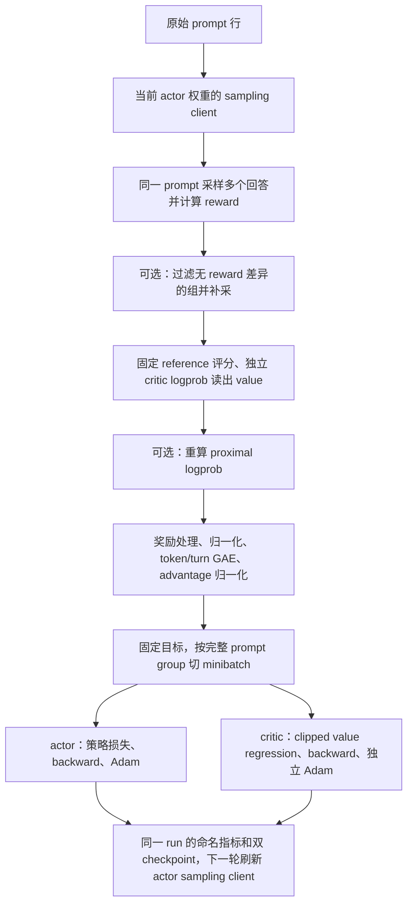

# PyTRIO PPO 算法族：接口、功能边界与测试方法

本文对应 [`trainer/ppo`](../triotune/trainer/ppo/) 的当前实现，
说明如何测试、已经实现哪些能力，以及与 AReaL 相比还缺少什么。
核对环境为 Python 3.12.14、PyTRIO 0.2.9、PyTorch 2.14.0+cpu、NumPy 2.5.3、SwanLab 0.10.1；
AReaL 参考版本为 `b2f2f56f3701f46fef867036797a44d9f8226546`。

## 1. 当前实现的定位

这是一个由配置选择算法的、基于 PyTRIO 远端 LoRA 训练的 PPO 算法族框架。
算法切换复用同一个 `PPOTrainer`，主要改变 reward baseline、归一化、概率比率和策略损失。
它没有完整搬运 AReaL 的 engine、集群调度和 workflow 运行时。

无 critic 的 GRPO、RLOO、GSPO 等路径已经接通采样、奖励、更新、日志和保存。
标准 PPO 默认创建两个独立的 PyTRIO LoRA 训练客户端：actor 和可训练的 critic。
critic 用两个固定 marker 的 logprob 差读出 value，经 GAE 生成 actor 的优势和 critic 的回归目标。
两者各有参数、Adam 状态、checkpoint 和 SwanLab run，冻结目标后可以并发更新。
PyTRIO 没有原生 value head 接口，但 logprob 和自定义损失接口足以实现这种 critic；
此前文档把“没有原生 value head”解释成“不能完成纯 PyTRIO PPO”，这个判断已纠正。

GRPO 不再保留独立 trainer；统一通过 `PPOTrainer` 与
`PPOConfig.for_algorithm("grpo")` 运行。
新接口统一从以下包导入：

```python
from triotune.trainer.ppo import (
    Critic, NormConfig, PPOActor, PPOConfig, PPOState, PPOTrainer, PyTRIOCritic,
    PreparedBatch, Trajectory, compute_gae, prepare_advantages, value_loss,
)
```

## 2. 训练流程和模块划分



| 模块 | 当前职责 |
| --- | --- |
| [cli_args.py](../triotune/api/cli_args.py) | 组合 `TrainingConfig`、`OptimizerConfig`、`PPORolloutConfig`、`PPOActorConfig`、`PPOCriticConfig` 等职责模块，并提供算法预设与旧扁平参数兼容层 |
| [contracts.py](../triotune/trainer/ppo/contracts.py) | `Trajectory`、`PreparedBatch`、`PPOState` |
| [rollout.py](../triotune/trainer/ppo/rollout.py) | 文本采样、reward 调用、动态补采、固定 reference 评分 |
| [advantages.py](../triotune/trainer/ppo/advantages.py) | 奖励整形、batch/group 归一化、KL reward 组合和优势归一化 |
| [gae.py](../triotune/trainer/ppo/gae.py) | 独立的 token/turn 级 GAE 递推、mask/bootstrap 与 turn metadata 校验 |
| [datum.py](../triotune/trainer/ppo/datum.py) | 因果 token 对齐、prompt/tool label mask、PyTRIO Datum 构建 |
| [loss.py](../triotune/trainer/ppo/loss.py) | PPO、SAPO、CISPO、GSPO 比率、双重裁剪、reduction、行为过滤 |
| [actor.py](../triotune/trainer/ppo/actor.py) | proximal 重算、目标冻结、minibatch 和重复更新 |
| [critic.py](../triotune/trainer/ppo/critic.py) | `PyTRIOCritic` 评分、更新、保存；保留外部 `Critic` 协议 |
| [critic.py](../triotune/trainer/ppo/critic.py) | marker targets、无界 value 读出、clipped value regression 和 critic 更新 |
| [metrics.py](../triotune/utils/metrics.py) | 单 run SwanLab 提交、指标规范化及 `log_dir` JSONL 历史 |
| [rl_trainer.py](../triotune/trainer/rl_trainer.py) | 训练编排、日志、actor/critic checkpoint 保存 |

初始化是惰性的；创建 `PPOTrainer` 本身不会立即创建远端训练客户端。
训练方法使用 `async/await`，同一批 prompt 的采样请求可以并发执行。
同一训练客户端的更新保持 `forward/backward 完成 → optim_step 完成` 的依赖顺序，
下一轮采样使用更新后的 actor 权重。**当前没有让新旧版本 rollout 持续并行的生产消费队列**，
也没有实现此前 SFT 中的多批提交流水线；不能仅凭 async 方法名判断会提速多少。

## 3. 已实现的接口

### 3.1 Trainer 和算法配置

| 接口 | 输入与返回 | 行为和边界 |
| --- | --- | --- |
| `PPOConfig.for_algorithm(name, **overrides)` | 算法名、覆盖参数 → `PPOConfig` | 预设只改变配置，不创建另一种 trainer；显式参数优先 |
| `PPOTrainer(model, args, train_dataset, reward_fn, ...)` | 服务端模型 ID、配置、可迭代数据和奖励函数 | 可注入 `training_client`、`critic_training_client`、`tokenizer`、`reference_client`、`service_client`、`critic`；默认 LoRA rank 32 |
| `await trainer.initialize()` | 无 → `None` | 创建独立 actor/critic client、获取 tokenizer、初始化一个实验 reporter；已完成时直接返回 |
| `await trainer.train()` | 使用构造时的数据与 reward → `PPOState` | 单遍读取数据，采样后训练；终端逐步显示 loss/reward/tokens，正常结束保存最终 actor/内置 critic checkpoint 并结束一个日志 run |
| `await trainer.evaluate(eval_dataset=None)` | 验证 prompt 与 reward → 标量指标字典 | 当前 actor 采样并汇总 reward、长度、截断和 token 用量；不调用 reference/critic、backward 或 optimizer，也不推进 global step |
| `await trainer.step(trajectories)` | 已生成的轨迹列表 → 标量指标字典 | 跳过内置采样及动态补采，执行 reference/value、冻结 GAE，再并发更新 actor/critic；不能在同一个 trainer 上并发调用 |
| `await trainer.save_checkpoint()` | 无 → 远端路径字符串 | 保存 actor/内置 critic 状态，更新 `state.checkpoint_path`/`state.critic_checkpoint_path`；返回 actor 路径；外部 critic 自管保存 |
| `await trainer.close(state="success", error=None)` | 无 → `None` | 结束统一实验 reporter；外部 critic 生命周期由调用者管理 |
| `await actor.prepare(trajectories)` | 轨迹 → `PreparedBatch` | 验证分组和数组对齐，可重算 proximal，计算并冻结 advantage/return |
| `await actor.update(prepared_batch)` | 冻结目标 → 指标字典 | 完成配置的 minibatch/epoch 更新，累计 `actor.optimizer_steps`；只操作策略，不负责 critic 或日志生命周期 |

`train()` 要求 `train_dataset` 和可调用的 `reward_fn`；自定义工作流可只使用 `step()`。
`step()` 不负责在调用序列结束后自动保存最终 checkpoint 或结束日志 run，
自定义工作流结束时应自行调用 `save_checkpoint()` 和 `close()`。

关键配置包括：

| 类别 | 配置 |
| --- | --- |
| 数据与采样 | `batch_size`、`num_generations`、`max_tokens`、`prompt_key`、`chat_template_kwargs`、`seed` |
| reward/GAE | `use_critic`、`reward_norm`、`adv_norm`、`reward_bias/scaling/clip`、`discount`、`gae_lambda`、`gae_timestep_unit` |
| critic 优化 | `critic_learning_rate`、`critic_lora_rank`、`critic_n_minibatches`、`critic_update_epochs` |
| critic 读出/损失 | `critic_token_ids`、`critic_value_scale`、`critic_value_bias`、`critic_eps_clip` |
| KL 和截断 | `kl_ctl`、`kl_estimator`、`mask_no_eos_with_zero`、`overlong_tokens`、`overlong_penalty_factor` |
| 损失 | `loss_type`、`eps_clip`、`eps_clip_higher`、`c_clip`、`importance_sampling_level`、`loss_aggregation`、`loss_aggregation_divisor` |
| 旧策略与过滤 | `recompute_logprob`、`use_decoupled_loss`、`rejection_lower/upper` |
| 更新与动态补采 | `ppo_n_minibatches`、`update_epochs`、`dynamic_sampling`、`max_empty_batches`、`max_steps` |
| 远端优化和日志 | 继承的 Adam 参数、`save_every`、`report_to`、`project`、`workspace`、`tags`、`run_name`、`log_dir` |

`batch_size` 是每轮接受的 prompt group 数；每组通常有 `num_generations` 条回答。
`max_steps`、`save_every`、SwanLab step 和 `state.global_step` 统计 rollout update，
`state.optimizer_steps` 和 `state.critic_optimizer_steps` 分别统计 actor 和 critic 实际完成的 Adam 更新。
例如两轮 rollout、每轮两个 minibatch、每个 minibatch 更新三次，optimizer step 为 12。
`train()` 不自动循环数据，数据用完就结束；`max_steps` 只是上限。

### 3.2 轨迹、reward 和 critic 契约

| 接口/字段 | 约定 |
| --- | --- |
| `reward_fn(*, row, completion, completion_ids)` | 返回有限标量，或含 `reward` 总分及数值分项的 mapping；支持普通函数和协程，普通函数在 worker thread 中执行 |
| `Trajectory.prompt_tokens` | 非空 prompt token ID 列表 |
| `completion_tokens`、`logprobs` | completion token 和其行为策略 logprob，长度均为 T；不是整段 prompt+completion 的 logprob |
| `reward`、`group_id` | 任务得分和 prompt 分组标识；同一 group 必须有完全相同的 prompt token |
| `loss_mask` | T 个布尔值，默认全为 True；工具返回可设为 False，仍保留上下文 token |
| `turn_ids` | 可选的 T 个整数；turn GAE 时必填。有效 action token 使用时间单调不减的 turn ID，mask 位置使用 `-1` |
| `truncated` | 是否因长度等原因截断；决定 GAE 是否使用 bootstrap |
| `reference_logprobs` | 可选的 T 个固定参考策略 logprob；`kl_ctl > 0` 且缺失时由 trainer 补算 |
| `values` | critic 路径需要 T+1 个 value；前 T 个对应 action 前的状态，最后一个是截断 bootstrap |
| `token_rewards` | 可选的 T 个任务/过程奖励增量；token 模式逐 token 进入 GAE，turn 模式按 turn 求和后进入 GAE |
| `Critic.compute_values(trajectories)` | 异步返回每条轨迹的 T+1 个真实 value |
| `Critic.update(trajectories, returns, masks)` | 异步拟合冻结 return，返回指标字典；critic 自己管理模型、optimizer 和 checkpoint |
| `value_loss(values, old_values, returns, mask, clip=0.2)` | 本地 torch clipped value regression；四个 tensor 形状相同，仅含 T 个 action 位置，不含 bootstrap |

`PreparedBatch` 保存轨迹、advantage、return、mask 和 frozen proximal logprob。
`PPOState` 保存 rollout step、两种 optimizer step、最新指标及 actor/critic checkpoint 路径。
`compute_gae()`、`compute_token_level_gae()`、`compute_turn_level_gae()` 与
`prepare_advantages()` 可独立调用，不依赖远端模型。

内置 `PyTRIOCritic` 的读出与训练如下：

```text
V(s) = critic_value_scale * [log p(positive|s) - log p(negative|s)] + critic_value_bias
delta_t = reward_t + discount * V(s_next) - V(s_t)
advantage_t = delta_t + discount * gae_lambda * advantage_next
return_t = advantage_t + old_value_t  # 使用归一化之前的 GAE advantage
```

`gae_timestep_unit="token"` 保持原有行为：每个有效 completion token 都推进一次
`discount` 和 `gae_lambda`。`"turn"` 则参考 AReaL，把每个非空 assistant turn
作为宏时间步：对 turn 内 task/process reward 求和，读取该 turn 第一个有效 action
位置的 value，执行一次 GAE，再把 advantage/return 广播回 turn 内全部有效 token。
prompt、tool 和其他 mask 位置不会消耗时间步，turn ID 允许跳号。

Turn 模式将 reference KL 保持为 token-local actor penalty，不把它纳入 turn recurrence
或 critic return。否则先对一个 turn 的 KL 求和、再把总和广播给 turn 内每个 token，
会重复放大 KL。正常 EOS 终止仍使用零 bootstrap；截断轨迹仍使用第 T+1 个 value。
内置 PyTRIO sampler 的一次 completion 自动标记为 turn 0；自定义多轮 rollout 通过
`PPOTrainer.step()` 提交 `Trajectory.turn_ids`。

这里需要区分三个互相独立的粒度轴：

| 粒度轴 | 配置 | 含义 | 典型用途 |
| --- | --- | --- | --- |
| 信用分配时间步 | `gae_timestep_unit=token/turn` | `gamma/lambda` 按 token 或 assistant turn 推进 | token PPO；多轮 agent PPO |
| 重要性采样比率 | `importance_sampling_level=token/sequence` | 每 token ratio 或整条 response 的几何平均 ratio | PPO/GRPO；GSPO |
| loss 归约 | `loss_aggregation=token_mean/seq_mean/prompt_mean/constant` | 决定不同长度 response 和 prompt group 的权重 | 长度公平、prompt 公平或固定 divisor |

因此 turn 级 GAE 本身不是另一种 PPO-family 算法，也不等同于 GSPO 的 sequence
ratio。它是可与 PPO、GRPO、RLOO、GSPO 等预设正交组合的信用分配策略；所谓“句子级”
在当前实现中应明确为整条 response 的 `sequence` ratio/reduction，而不是按自然语言句号切分。

两个 logprob 的 log-softmax 归一化项抵消，等价于两个词表 logit 的差，可以表示正负无界 value。
默认 marker 为 tokenizer 编码的 `"1"`、`"0"`；必须各是一个不同的既有 token，
否则通过 `critic_token_ids=(positive_id, negative_id)` 显式指定。它们是固定 target，
不需要让 critic 生成数字，也不会把 marker 插入真实上下文。
每条轨迹两个 Datum 的 input 都是完整 prompt+completion，`auto_shift=False`，
target 在 prompt 长度 P 之前的 P-1 个位置设为 -100，之后 T+1 个位置设为 marker。
从输出的 P-1 位置开始读取，依次得到 action 前状态 V(s_0)..V(s_T)，最后一个是 bootstrap。
因果 attention 保证 V(s_t) 不读取尚未采取的 action。

critic 回归本轮冻结的 return，采用 `0.5 * max((V-return)^2, (V_clipped-return)^2)`，
按有效 action token 取平均；排除 prompt、工具 mask 和 bootstrap 位置。
`forward_backward_custom` 同时对两个 logprob 求导，SDK 用相反符号的 CE weights
把梯度传给远端 critic，再执行它自己的 Adam 更新。actor 仅使用冻结的 value/advantage，
不对 critic 反传。该参数化无需新增 value head，但不承诺与 AReaL 的 value head 数值一致。

critic 的 learning rate/rank 默认继承 actor，可用 `critic_learning_rate`、`critic_lora_rank` 覆盖。
其他默认值为 scale=1、bias=0、`critic_eps_clip=0.2`、`critic_n_minibatches=1`、
`critic_update_epochs=1`；marker 和 scale/bias 在训练中固定。
critic 按轨迹切 minibatch，数量不得超过有效轨迹数；每个 epoch 使用同一份旧 value 和 return。
两个客户端必须使用相同的基座/tokenizer；注入 `critic_training_client=` 时也遵守此要求。
默认 actor seed 为配置的 seed，critic 为 seed+1；未设置 seed 时均交给服务端决定。
外部 `critic=` 和 `critic_training_client=` 不能同时传入，actor/critic 不能共享同一训练客户端。

### 3.3 实际使用的 PyTRIO 接口

| PyTRIO 对象/方法 | 在本实现中的用途 |
| --- | --- |
| `ServiceClient.create_lora_training_client_async` | 创建独立 actor/critic LoRA 训练客户端，传入模型、各自 rank 和 seed |
| `TrainingClient.get_tokenizer` | 获取 tokenizer；SDK 无对应异步 getter，在本地线程调用 |
| `TrainingClient.save_weights_and_get_sampling_client_async` | 获取当前 actor 权重的采样客户端，每轮更新后刷新 |
| `SamplingClient.sample_async` | 为每个 prompt 采样一组回答，取得 token、logprob、停止原因 |
| `ServiceClient.create_sampling_client_async` | 默认创建固定基座 reference；也允许注入其他固定 reference client |
| `SamplingClient.compute_logprobs_async` | 计算固定 reference 的整段 logprob，再切出 completion |
| `TrainingClient.forward_async(loss_fn="cross_entropy")` | 重算 proximal；以及两个 marker 的 critic 评分，均不更新参数 |
| `TrainingClient.forward_backward_custom_async` | 策略/价值目标：本地对 logprob 求导，再由 SDK 发送远端 CE backward |
| `TrainingClient.forward_backward_async(loss_fn="ppo")` | 可选的原生 PPO 损失，裁剪阈值使用 `clip_low_threshold/high_threshold` |
| `TrainingClient.optim_step_async` | 执行远端 Adam 更新 |
| `TrainingClient.save_state_async` | 分别保存 actor/critic 训练状态，返回两个远端 checkpoint 路径 |

客户端适配器 `call_async()` 会解析 SDK 的“提交协程 → APIFuture → 结果”两阶段返回。
自定义目标的 SDK 梯度转换为 `CE weights = -d(loss)/d(logprob)`，
因此本地只需 CPU PyTorch，不下载 actor 参数，也不在本地运行模型 forward。

## 4. 已实现的算法和功能

### 4.1 算法预设

| `for_algorithm()` 名称 | 相对共享流程的主要变化 | 当前可用条件 |
| --- | --- | --- |
| `ppo` | 独立 critic value + GAE，不做 outcome reward 归一化 | 默认内置 `PyTRIOCritic`，全流程使用 PyTRIO；仍可注入外部 critic |
| `grpo` | 组内 reward 减均值、除标准差；无 critic | 默认 custom 路径 |
| `drgrpo` | 组内 reward 减均值、不除标准差 | 对应 AReaL 示例的 reward normalization 设置 |
| `liteppo` | 组内均值 baseline、batch 标准差 | 无 critic |
| `rloo` | 用同组其他回答的均值作 baseline | 无 critic；单成员组按 singleton 规则得到零 centered reward |
| `reinforce` | 不做 outcome reward 归一化、无 critic | 仍使用共享 PPO surrogate，多次更新时仍有裁剪 |
| `reinforce_baseline` | 组均值 baseline、不除标准差 | 无 critic |
| `gspo` | ratio 为序列 log-ratio 均值的指数，advantage 也按序列取均值 | 使用 custom backend |
| `sapo` | 正负 advantage 分别使用 sigmoid gate 目标 | 使用 custom backend，不兼容 decoupled loss |
| `cispo` | 对裁剪后的 ratio detach，梯度经当前 logprob 传播 | 使用 custom backend、token ratio、显式 upper clip |
| `dapo` | 动态补采、非对称 clip、超长惩罚 | 使用至少两个回答；短回答预算须同步减小 `overlong_tokens` |

所有预设默认还有 batch 级 advantage 归一化，可用 `adv_norm=None` 关闭。
预设表达的是本次选择的 AReaL 风格配置组合，**不代表逐项复刻论文默认配置或官方训练结果**。
例如 `drgrpo` 没有自动设置论文常用的 constant reduction；需要实验者显式配置。

### 4.2 共享功能

| 功能 | 当前实现 |
| --- | --- |
| 可变 group 大小 | 用显式 `group_id` 分组，不依赖固定 reshape；内置采样仍要求每个请求返回配置数量的回答 |
| reward/advantage normalization | mean/std 可分别选 batch、group 或关闭；支持 unbiased std、leave-one-out、singleton fallback |
| token/turn GAE | token 模式逐有效 token 递推；turn 模式聚合 task reward、广播 turn target，并保持 KL 为 token-local；两者均支持 mask 与终止/截断 bootstrap |
| KL reward | 支持 k1/k2/k3，估计量限幅到 [-10, 10] 后乘 `kl_ctl` 加入 token reward |
| 截断 reward 处理 | `mask_no_eos_with_zero=True` 清零截断样本的 outcome/token reward，保留 KL 和 critic bootstrap |
| 策略裁剪 | 普通和非对称 PPO clip、dual clip；GSPO、SAPO、CISPO 的相应目标 |
| reduction | token mean、每回答 token mean 后平均、每 prompt 内 token mean 后平均、固定长度 divisor |
| decoupled loss | 重算 proximal，保留 behavior；普通重算则连同 KL reward 的旧 logprob 一起替换 |
| 行为过滤 | token 级 proximal/behavior ratio 上下界 mask，以及 detached 行为校正权重；只过滤分子，保留原分母 |
| 多次更新 | 一轮采样内冻结目标，执行多个 minibatch 和 update epoch；完整 group 不拆开 |
| 动态补采 | 按原始 reward 过滤组内全部相同的回答组；补采到 batch size 或数据耗尽，连续空批数有上限 |
| 长度惩罚 | 在 reward bias/scaling/clip、归一化之前施加逐渐增加的超长惩罚 |
| 保存与日志 | 周期/最终 actor+critic 保存、同一 SwanLab run 中的命名标量和双 checkpoint URI、`log_dir` JSONL 历史 |

`ppo_n_minibatches` 不能超过当前有效 prompt group 数，包括最后一个不满 batch 的情况。
native backend 仅接受普通 token-ratio PPO、token mean 和常规 clip；
需要 GSPO、SAPO、CISPO、dual clip、decoupled 或过滤时应使用 custom。
native PPO 的梯度归一化还受 Trio-Train 服务端配置影响，不能默认与 custom 完全相同。

## 5. 如何测试

以下命令均在仓库根目录 `/data/home/wzc/triotune` 执行。

### 5.1 安装与本地自动测试

```bash
uv sync --extra ppo
uv run --extra ppo python -m unittest discover -s tests -p 'test_ppo*.py' -v
```

核心测试文件为 [test_ppo_family.py](../tests/test_ppo_family.py)（32 项）和
[test_ppo_critic.py](../tests/test_ppo_critic.py)（15 项），另有 2 项配置文件测试，共 49 项。
这些测试不需要 PyTRIO 服务凭据，不创建真实远端模型，也不向 SwanLab 上传训练轨迹。
已有 CPU PyTorch 环境可直接使用 `.venv/bin/python` 执行测试，无需重复安装 GPU 版 PyTorch。

| 测试部分 | 检查内容 |
| --- | --- |
| `AdvantageTests` | 可变组和 singleton、RLOO baseline、reward/advantage 归一化、token/turn GAE、turn metadata、工具 mask、KL、超长/截断处理、无效配置 |
| `PolicyLossTests` | PPO clip 和 dual clip 梯度、GSPO 几何比率、SAPO/CISPO、不同长度的 reduction、过滤分母、因果对齐、value loss、有限差分梯度和溢出失败 |
| `CriticLossTests`、`PPOCriticTests`、`ReporterProcessTests` | marker 因果对齐、无界读出、梯度有限差分、mask/bootstrap、独立优化器与 checkpoint、GAE 目标冻结、实际回归学习、并发更新、统一 reporter 和异常清理、历史隔离 reporter utility、真实 SDK 的正负 CE 权重 |
| `AsyncTrainerTests` | 两阶段 future 顺序、策略刷新和 seed、各预设共用 actor、native 参数、固定 reference、外部 critic 调用、动态补采、失败状态和 SDK 梯度转换 |

其中 `test_all_presets_use_same_loop_and_native_threshold_contract` 遍历无 critic 预设，
验证共用 actor 的 prepare/update 和原生参数契约；它不是每种算法的真实远端训练实验。
`test_real_sdk_custom_bridge_sends_negative_local_gradient` 调用安装的真实 SDK 梯度转换代码，
仅将 remote forward/backward 替换为测试 transport。它验证 CE 权重的符号、mask 和缩放，
不验证在线服务兼容性或真实模型梯度。

需要检查是否影响原有 trainer 时运行：

```bash
uv run --extra ppo python -m unittest discover -s tests -p 'test_*.py'
```

### 5.2 真实远端链路验收示例（已完成两步实验）

先通过现有 PyTRIO 登录/配置提供有效凭据和服务地址，并选择服务端实际支持的模型。
此测试会创建远端 LoRA、执行训练和保存 checkpoint；下面给出可复用的验收命令，已完成的实际结果见第 5.5 节。

```bash
export PPO_TEST_MODEL='Qwen/Qwen3.5-4B'
# 默认只保存本地离线日志；设为 online 可上传，需先完成 SwanLab 登录。
export SWANLAB_MODE=offline
uv run --extra ppo python - <<'PY'
import asyncio
import math
import os

from triotune.trainer import (
    CheckpointConfig,
    OptimizerConfig,
    PPOActorConfig,
    PPOConfig,
    PPOCriticConfig,
    PPORolloutConfig,
    ReportingConfig,
    TrainingConfig,
)
from triotune.trainer.ppo import PPOTrainer


def reward(*, row, completion, completion_ids):
    # 仅作链路验收的简单奖励，不作为数学正确性评测器。
    return float(row["answer"] in completion)


async def main():
    rows = [
        {"messages": [{"role": "user", "content": "只输出数字：1+1=?"}], "answer": "2"},
        {"messages": [{"role": "user", "content": "只输出数字：2+2=?"}], "answer": "4"},
    ]
    args = PPOConfig.for_algorithm(
        "ppo",
        training=TrainingConfig(batch_size=1, max_steps=2, seed=42),
        optimizer=OptimizerConfig(learning_rate=1e-5),
        checkpoint=CheckpointConfig(save_every=0),
        rollout=PPORolloutConfig(
            num_generations=2,
            max_tokens=16,
            chat_template_kwargs={"enable_thinking": False},
        ),
        actor=PPOActorConfig(
            discount=0.99,
            gae_lambda=0.95,
            adv_norm=None,
            kl_ctl=0.0,
            loss_backend=os.getenv("PPO_TEST_BACKEND", "custom"),
        ),
        critic=PPOCriticConfig(
            lora_rank=8,
            optimizer=OptimizerConfig(learning_rate=1e-4),
        ),
        reporting=ReportingConfig(
            report_to="swanlab",
            project="ppo-family-smoke",
            run_name="ppo-single-run-smoke",
            log_dir="/tmp/ppo-single-run-smoke",
        ),
    )
    state = await PPOTrainer(
        os.environ["PPO_TEST_MODEL"], args, rows, reward_fn=reward, lora_rank=8,
    ).train()
    assert state.global_step == 2
    assert state.optimizer_steps == state.critic_optimizer_steps == 2
    assert state.checkpoint_path and state.critic_checkpoint_path
    assert all(math.isfinite(v) for v in state.metrics.values())
    print("actor checkpoint:", state.checkpoint_path)
    print("critic checkpoint:", state.critic_checkpoint_path)
    print("metrics:", state.metrics)


asyncio.run(main())
PY
```

验收时检查：完成两轮 rollout、actor/critic 各两次 Adam 更新、无非有限指标、两份有效远端路径；
一个 SwanLab run 正常结束，图表同时包含 `train/*` 与 `critic/*`，并记录两条 checkpoint URI。
示例使用 Qwen 的聊天模板选项，更换模型时需要确认该模板是否接受 `enable_thinking`。
如需验证 native 请求链路，可设 `PPO_TEST_BACKEND=native` 后重新执行完整命令；
两种 backend 的成功都不能单独证明梯度归一化完全相同。

本测试成功只能说明 PPO 双模型链路可运行，不证明 reward 将持续提高或模型已收敛。
两步实验还检查了 critic 更新后同一批状态的 value 确实改变；这仍不是长期学习效果评估。
更长的学习效果测试应使用足够多的真实任务数据、可区分回答的奖励和固定验证集。

### 5.3 标准 PPO 的 critic 怎么验证

默认 `PPOConfig.for_algorithm("ppo")` 无需传入 `critic=`。
`test_default_ppo_creates_two_independent_clients_and_saves_both` 验证独立参数/Adam/seed/rank 和双保存；
`test_critic_really_learns_return_and_keeps_actor_untouched` 使用可导小型因果 LM 拟合冻结 return，
验证损失下降且 actor 未被 critic 更新修改；不是只测试固定值接口。
`test_causal_values_cannot_see_future_actions` 验证未来 action 不会影响之前的状态 value；
`test_real_sdk_bridge_transmits_both_value_gradients` 验证真实 SDK 发送正负 CE 权重。
GAE 接收 critic 的 T+1 value，critic 只回归 mask=True 的前 T 个 action 状态；
最后 bootstrap 不参与 regression，正常终止的 GAE 不使用它。
第 5.2 节可运行完整远端 PPO；第 5.5 节记录了真实实验的两种 optimizer 和 value 变化。

### 5.4 对照 AReaL 的数值与训练结果

本次实现阶段曾直接加载本地 AReaL 原始损失函数，比较 PPO/SAPO/CISPO、token/sequence ratio、
token/sequence/constant reduction 的 15 种组合，loss 和 logprob 梯度均通过
`rtol=1e-6, atol=1e-7` 的断言。这是历史手工核对，脚本未纳入仓库自动测试；
它没有覆盖 AReaL 全部功能，也不代表本节命令会再次执行该项对照。

继续做等价性检查时，应先固定同一批 token、mask、reward、behavior/proximal/reference logprob、
value 和 group 边界，分别比较 reward 处理、advantage/return、最终 loss、`dL/dlogprob`，
再比较远端一步更新。不能只比较同名算法的默认配置。
学习曲线对比还需统一初始 LoRA、数据顺序、聊天模板、奖励、optimizer、reduction、更新次数及服务版本。
即使 seed 相同，远端采样和并行计算也不保证逐位复现。

### 5.5 当前验证结果与未验证项

| 项目 | 当前证据 |
| --- | --- |
| PPO 专项自动测试 | 当前 49 项通过；命令见第 5.1 节 |
| 仓库回归测试 | 当前 199 项通过；命令见第 5.1 节 |
| AReaL 原始函数差分 | 实现阶段手工检查 15 组 loss/梯度组合通过，不在自动测试中 |
| 静态检查和打包 | 实现阶段 Ruff、格式、diff whitespace 检查通过，wheel 包含全部 14 个 PPO Python 模块 |
| 真实 PyTRIO 模型训练 | 2026-10-16，Qwen/Qwen3.5-4B 双 LoRA：两轮 rollout，actor/critic 各两次更新，全部指标有限，双 checkpoint 保存成功 |
| 内置 critic 的实际更新 | 同一批状态更新前后 value 的平均绝对变化分别为 2.72917、2.12500；末轮 actor loss=-3.37884、critic loss=12.05609 |
| 改动前的 SwanLab 双 run | 2026-10-16 的历史烟测产生两个离线 run；当前实现已改为单 run，需在下一次真实训练中重新验收图表 |
| 与 AReaL 的 reward 曲线、收敛效果和吞吐量 | 尚未做对照实验，不能给出一致性或加速结论 |

本次真实实验配置为：`batch_size=1`、`num_generations=2`、`max_tokens=16`、两边 LoRA rank=8，
actor LR=1e-5、critic LR=1e-4、seed=42/43、discount=0.99、lambda=0.95、`adv_norm=None`。
使用两条相同的 `只输出数字：1+1=?` prompt 和包含 `2` 得 1 分的简单链路奖励。
actor checkpoint：`trio://run_aiow2a1uajlo/weights/ppo-step-00000002`；
critic checkpoint：`trio://run_r09dy0nbfcwv/weights/ppo-critic-step-00000002`。
改动前的离线日志分别为 `/tmp/ppo-two-run-smoke/run-20261016_175058-51d9r3m3`（actor）和
`/tmp/ppo-two-run-smoke/run-20261016_175059-p7g162s9`（critic）；它们只作为旧实现的历史证据。
这些 checkpoint 和临时日志依赖当前服务/机器保留状态，并未纳入仓库。

## 6. 哪些 AReaL 接口和功能没有实现，为什么

本节区分“需要 SDK/服务端提供能力”和“客户端代码尚未移植”。
后者不能解释成 PyTRIO 完全做不到；许多功能可以继续在现有 logprob 接口之上开发。

### 6.1 受当前 PyTRIO 公开接口限制的部分

| AReaL 能力/对应接口 | 当前缺失 | 原因与可能补齐方式 |
| --- | --- | --- |
| 原生独立 value head | 用已有输出层的两个 marker logprob 差替代新建标量 head；critic 评分和回归更新已实现 | SDK 不暴露新增 head/hidden state；当前参数化可完成 PPO，但不与 AReaL 原生 value head 数值等价 |
| engine 侧 logits/价值等非目标-token 输出 | 没有基于完整词表的精确 entropy/全分布 KL 等目标 | 本次采用的 custom-loss 回调只收到目标 token logprob。需增加可导全词表/其他模型输出接口；已有采样 KL reward 不等同于全分布 KL |
| actor 在任意温度分布上的一致训练计算 | 配置要求 `temperature=1、top_p=1` | 当前目标-token 接口不足以重建温度或 nucleus 变换后的全词表归一化；这是本实现的正确性限制，不是 PyTRIO 采样 API 不支持温度/top-p |
| `RLTrainer._create_train_engine()`、`_init_scheduler()`，FSDP/模型并行、onload/offload、模型共置 | 没有对应集群控制接口 | GPU、engine 和资源生命周期由 PyTRIO 服务托管。客户端复用其服务能力，无法用现有训练请求直接配置 AReaL 的集群拓扑和生命周期 |
| R3/MoE replay 与 engine side channel | 没有 router replay 信息和对应调用 | 当前轨迹只传 token、mask 和标量/逐 token 信号，没有 AReaL 特有的路由元数据及训练引擎契约；需要相应服务能力和轨迹扩展 |

### 6.2 可以继续开发，但本轮没有移植的部分

| AReaL 能力/对应接口 | 当前实现的差别 | 未实现原因 |
| --- | --- | --- |
| 异步 rollout 队列、staleness 控制、`_update_weights_and_publish_version()` | 只在一轮中并发采样，更新后刷新 sampling client；无持续生产消费、显式版本发布 | 目前选择逐轮策略一致性；需额外的队列、背压、版本记录、失败处理和过期策略。部分权重分发细节还依赖服务端 |
| 完整 workflow/agent/proxy 运行时，`_init_rollout()`、`_ensure_proxy_started()` | 只有文本单次采样；`step()` 可接收外部工作流已完成的轨迹 | 多轮工具执行、环境交互和会话状态管理尚未实现；接受工具 mask 不等于内置 agent 引擎 |
| 自定义 `gae_lambda` 函数 | 已支持 token/turn GAE，但 lambda 仍是全局标量 | 没有移植 AReaL 的逐轨迹动态 lambda 回调、长度上下文及配置加载；可以在客户端继续扩展，并非 SDK 的硬限制 |
| PRM、`token_rewards_as_adv`、GVPO/process-weighted shaping | `token_rewards` 已按所选 token/turn 时间步进入 GAE | 没有移植 AReaL 的 GAE 后直接 advantage shaping、GVPO/process-weighted 组合和对应 scorer 数据语义 |
| 完整 `RejectionSamplingConfig` | 仅 token ratio 上下界 mask；无 sequence/其他 metric、clamp 等模式 | 当前只实现已验证的一个子集；许多其他模式也可用现有 logprob 计算 |
| rollout export、logical group、分段轨迹/高级 reward normalization | 一条 `Trajectory` 对应一条 completion，显式 group ID；无完整 exporter metadata | 数据契约有意简化，缺少跨片段关系与逻辑成员计数；部分超长惩罚归一化不保证与这些路径相同 |
| 跨 group 切分、packing、分布式 microbatch reduction | 完整 prompt group 不拆开；没有客户端 packing 和 engine microbatch weight 协议 | 简化为请求级更新；服务端可能自行 packing，但这不是对 AReaL reduction 调度的复刻 |
| `_evaluate_before_train()`、`_evaluate()`、独立 eval rollout | `PPOTrainer.evaluate()` 复用当前 actor 的 rollout/reward 契约，支持训练前、周期和训练后调度 | 当前评估聚合 task reward、生成长度、截断比例和 sampling token 用量；不执行 critic/reference 评分 |
| `_save_recover_checkpoint()`、`_recover_engines()`、数据迭代器恢复、`_save_hf()` | 分别保存远端 actor/critic 状态；无统一加载恢复、HF 格式导出或原子联合 checkpoint | 恢复还需要保存本地 step/group/数据位置、两种 optimizer/checkpoint 的配对与加载逻辑；SDK 有保存能力不代表 trainer 已实现恢复 |
| 多 epoch 数据管理、shuffle、学习率 scheduler | 单遍 iterable、固定配置的学习率；`update_epochs` 只重复同一批 rollout | 尚未添加数据 epoch 和调度器状态；调用者可以提供重复/打乱的数据，但框架不负责其恢复 |
| MOPD teacher、`configure_mopd_loss()`、teacher rollout 与聚合 | PPO 包中没有这些 teacher/controller 接口 | 属于额外的蒸馏和多模型协同能力，本轮聚焦 PPO 算法族；仓库其他 OPD 入口也不等同于 AReaL 的 MOPD 实现 |
| 多模态训练轨迹 | 当前只接受文本/token prompt 和 completion | 数据契约、mask 和 Datum 构造未接入图像/视频块；不能仅因 SDK 存在相关输入类型就声明框架已支持 |
| `_config_perf_tracer()`、`_save_perf_tracer()`、细分 engine 指标 | 只有训练标量与粗粒度计时；已有 trainer.close() 结束自有 reporter | 完整性能跟踪和生命周期管理未移植，且 GPU/服务端内部耗时需要额外遥测 |

对未支持配置，已存在的显式检查会报错；未列为配置的 AReaL 接口也没有提供空壳方法。
当前不是 AReaL Python API 的兼容层，不能直接把 AReaL YAML 或 `RLTrainer` 调用原样传入。

## 7. 日志如何验收和解释

`report_to="swanlab"` 启用云端图表，不启用时仍有终端进度和 `state.metrics`。
训练使用 `PPO train` step 进度条，评估使用独立的 `PPO eval` batch 进度条；
可求长度的数据展示准确总 batch 数，流式 iterable 展示已完成 batch 与速率。
只要配置 `log_dir`，`MetricsAPI` 就会另外创建唯一的 `metrics-<UTC时间>-<ID>.jsonl`：
逐步保存规范化指标，保存 checkpoint URI，并在结束事件中写入最终指标和成功/失败状态。
该文件不包含模型权重；actor/critic checkpoint 仍是 PyTRIO 云端 URI。

| 指标 | 口径 |
| --- | --- |
| `reward/mean`、`reward/std` | 本轮已接受轨迹的原始任务 reward；不是经长度惩罚、KL 和归一化后的训练信号；std 为总体标准差 |
| `train/loss` | custom 路径的实际策略目标，跨 minibatch/update epoch 按 loss reduction 的自然分母聚合；不是 CE 梯度代理损失 |
| `policy/ratio`、`policy/clip_fraction`、`policy/rejected_fraction` | custom 路径的概率比、裁剪/过滤统计；多个更新的返回指标取平均 |
| `policy/update_approx_kl`、`policy/ratio_std/p95/max`、`policy/clip_fraction_low/high` | 当前策略相对 frozen proximal policy 的 sampled update drift 和 ratio 分布；不是完整词表 KL |
| `policy/reference_kl_sampled`、`reward/kl_penalty_mean` | 启用 reference scoring 时，行为策略相对固定 reference 的采样 log-ratio，以及按所选 estimator、限幅和 `kl_ctl` 得到的实际平均惩罚 |
| `policy/entropy_sampled`、`advantage/mean/std`、`return/mean/std` | rollout action 的负平均采样 logprob，以及有效 action 上的冻结 advantage/return 分布；sampled entropy 不是完整词表精确 entropy |
| `rollout/completion_length_*`、`rollout/truncated_fraction` | 训练 rollout 的 completion 长度和长度截断比例；DAPO 另记录退化组、拒绝组和补采次数 |
| `train/action_tokens` | 本轮 mask=True 的 completion token 总数；行为过滤保留原分母，因此不扣掉被 rejection 过滤的 token |
| `train/trajectories`、`train/prompt_groups` | 本轮接受的回答数和 prompt group 数 |
| `train/optimizer_steps` | 累计成功完成的 Adam update 数 |
| `train/grad_norm`、`critic/grad_norm` | PyTRIO `optim_step` 返回时记录的 actor/critic 梯度范数；服务端不返回时该指标不存在 |
| `critic/loss`、`critic/value_mean/std`、`critic/return_mean/std`、`critic/explained_variance`、`critic/clip_fraction` | clipped value MSE、value/return 分布、冻结 value 对 return 的解释方差，以及裁剪分支实际主导损失的 token 比例 |
| `critic/optimizer_steps`、`critic/learning_rate`、`critic/action_tokens` | critic 累计已完成的 Adam 次数、独立学习率及本轮有效 action 数 |
| `time/critic_update` | critic 回归更新的墙钟时间，与 actor 更新可重叠 |
| `time/prepare` | reference、critic value、proximal 重算与优势准备的客户端墙钟耗时，不含惰性初始化 |
| `time/update` | actor 和 critic 并发更新的客户端墙钟耗时 |
| `time/rollout` | `train()` 中策略采样 client 准备、采样、reward 和补采时间 |
| `time/step` | `train()` 一轮的墙钟时间，包含该轮周期保存；最终保存与首次初始化不完整包含在内 |
| `checkpoint/actor_path`、`checkpoint/critic_path` | 同一 run 与 JSONL 中记录的两条远端 URI；不是本地权重目录 |

native backend 的损失指标取决于服务端返回，外部 critic 指标由其 `update()` 提供。
内置 critic 启用时只创建 `<run_name>` 一个 SwanLab run；策略指标使用 `train/*`、`policy/*`，
价值模型指标使用 `critic/*`。这与 AReaL 把各组件命名指标汇总给同一个 `StatsLogger` 的方式一致。
actor 与 critic 仍是两个独立 PyTRIO 客户端，日志合并不改变参数、优化器或 checkpoint 边界。
更新与保存并非原子事务；发生异常可能有一个模型已更新，状态计数反映已确认完成的更新，
不能把错误重试当成无副作用操作。外部 critic 的保存和关闭仍由注入方负责。
直接使用 `step()` 不生成 `time/rollout`、`time/step` 两项。
当前输出基于已采样 action 的 KL 与 entropy 估计，不等于完整词表精确统计；GPU 利用率和
服务端排队时间仍不在客户端公开接口中。

## 8. 对照源码

- [本实现目录](../triotune/trainer/ppo/) 与 [自动测试](../tests/test_ppo_family.py)。
- [AReaL RLTrainer](https://github.com/inclusionAI/AReaL/blob/b2f2f56f3701f46fef867036797a44d9f8226546/areal/trainer/rl_trainer.py)：训练编排、资源、评估和恢复。
- [AReaL PPO actor](https://github.com/inclusionAI/AReaL/blob/b2f2f56f3701f46fef867036797a44d9f8226546/areal/trainer/ppo/actor.py)、[critic](https://github.com/inclusionAI/AReaL/blob/b2f2f56f3701f46fef867036797a44d9f8226546/areal/trainer/ppo/critic.py)、[GAE](https://github.com/inclusionAI/AReaL/blob/b2f2f56f3701f46fef867036797a44d9f8226546/areal/trainer/ppo/gae.py)。
- [AReaL 策略目标](https://github.com/inclusionAI/AReaL/blob/b2f2f56f3701f46fef867036797a44d9f8226546/areal/utils/functional/functional.py) 与 [loss reduction](https://github.com/inclusionAI/AReaL/blob/b2f2f56f3701f46fef867036797a44d9f8226546/areal/trainer/ppo/loss_reduction.py)。
- [Trio-Train](https://github.com/SwanHubX/Trio-Train)：原生损失和服务端 CE/PPO 契约；实际部署的服务版本仍需在远端验收时核对。
